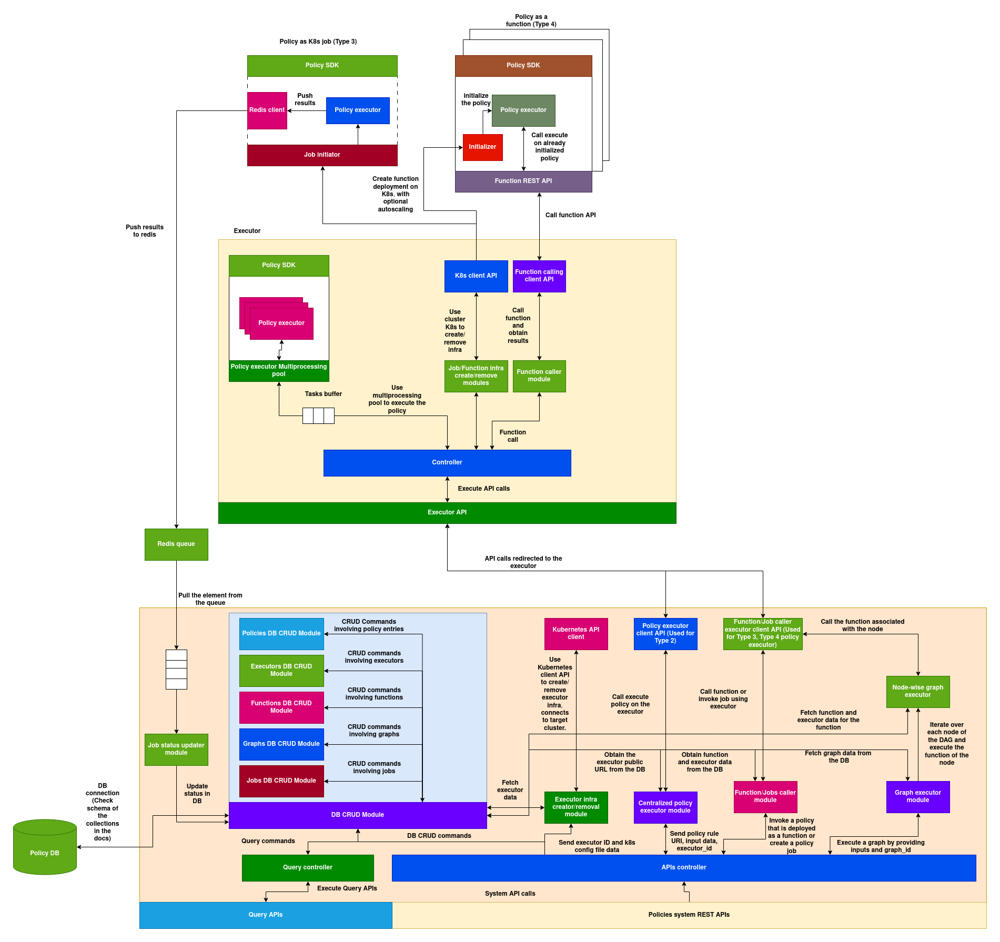

# Policies:

## What is a policy?
A policy is a dynamically loadable, executable Python code that is used in various places and use cases across the AIOS system. Since policies are dynamic, they allow developers to implement custom functionalities throughout the AIOS system. Below are some examples of polices used in AIOS:

**1. Auto-scaler Policy in Block:** Enables developers to build custom autoscaling mechanisms for upscaling or downscaling the instances of a block based on demand.

**2. Load Balancer Policy in Block:** Allows developers to create custom load-balancing strategies tailored to their specific block requirements.

**3. Template Parser Policy in Parser:** Enables developers to define custom, user-friendly specifications for vDAGs, blocks, and other components in their network, instead of relying solely on the default specification.

**etc.**
 
Policies are used in many components and for various purposes. Overall, they enable developers to implement custom functionality on top of the existing system wherever customization is supported. This flexibility makes AIOS a general-purpose platform that does not impose rigid constraints, empowering developers to make decisions as needed.

## System Architecture:

[Download Image](./policy-system.png)

## Types of Policy Execution

Policies can be executed in five different ways across the AIOS system.

### 1. Type 1: Policy loaded and executed as part of another AIOS application inside its own process space

Any service that implements and uses the Local Policy Evaluation SDK can download the policy code and execute it locally to extend its own functionality. These policies can be stateful or stateless depending on how the application uses them. Refer to the Local Policy Evaluation Guide to understand how to load and execute a policy locally within the application space.

**Characteristics**:

1. **Policy Lifecycle**: Completely dependent on the application. The application can load and terminate the policy at any time.
2. **Communication**: Communication between the policy and the application happens through in-process memory.
3. **Scaling**: Scaling is not handled implicitly. The application decides when to create another process/thread as per its own requirements.
4. **Fault Tolerance**: Depends on the fault tolerance of the application.

### 2. Type 2: Policies executed by the central policy executor

Applications can tap into the online policy executors to execute policies and fetch results using the **Policy System APIs**. In this case, the policy is executed by the policy executor with its own memory and resources, which the application does not need to provide. Developers can also deploy their own policy executor on a remote machine and use it with their application (refer to the Policy System Guide for more details).

**Important**: Type 2 policy execution mode can only be used for stateless policies. Refer to Type 4 for stateful remote policy deployments.

**Characteristics**:

1. **Policy Lifecycle**: Stateless. The policy is loaded into the executor's memory and evicted once execution is complete.
2. **Communication**: Communication between the policy and the application happens through a REST API over HTTP. Execution is handled by the executor.
3. **Scaling**: Not handled implicitly. The executor can scale its instances based on load.
4. **Fault Tolerance**: Depends on the fault tolerance of the executor.

### 3. Type 3: Policies deployed on remote clusters as jobs

Policies can be deployed as jobs on a remote cluster that has a registered policy executor. This type is useful for scenarios where you want to run a resource-heavy policy one-time on a remote node, without persistence. It can also be used to gather data about the remote cluster—such as metrics, available resources, or node health.

**Important**: Type 3 policy execution is stateless; its lifecycle begins and ends as a one-time job.

**Characteristics**:

1. **Policy Lifecycle**: Stateless. The policy runs as a Kubernetes Job and is terminated by Kubernetes upon completion.
2. **Communication**: The application cannot communicate with the policy during execution—it can only wait for the results.
3. **Scaling**: Not applicable.
4. **Fault Tolerance**: Handled by Kubernetes.

### 4. Type 4: Policies deployed as stateful online functions

Policies can be deployed as stateful functions that expose their services via the Policy System Service (refer to the Policy System section below). These functions can be invoked via REST API.

**Characteristics**:

1. **Policy Lifecycle**: Stateful. Initialized once after function deployment and runs as a pod on Kubernetes.
2. **Communication**: Communication between the policy and the application happens through a REST API over HTTP.
3. **Scaling**: Autoscaling rules can be set at the time of function creation.
4. **Fault Tolerance**: Handled by Kubernetes.

### 5. Type 5: Policies as a graph

Static DAGs (Directed Acyclic Graphs) can be defined over policies deployed as Type 4 functions. Each node in the DAG is a policy function. These graphs are pre-defined, stored in a registry, and can be searched and executed using a graph ID.

**Characteristics**:

1. **Policy Lifecycle**: Nodes in the graph are stateful and inherit the same properties as Type 4 policies.
2. **Communication**: Communication between graph nodes is orchestrated by the Policy System (refer to Policy System APIs).
3. **Scaling**: Nodes can be individually scaled, as each one is a Type 4 policy function.
4. **Fault Tolerance**: Handled by Kubernetes.

Here's a table summarizing the five types of policy execution across the AIOS system:

| **Type** | **Description** | **Policy Lifecycle** | **Communication** | **Scaling** | **Fault Tolerance** |
|---------|------------------|----------------------|-------------------|--------------|----------------------|
| **Type 1** Policy loaded and executed inside an AIOS application | Executed within the application's own process using the Local Policy Evaluation SDK | Managed by the application; can be loaded/unloaded anytime | In-process memory | Handled by the application (manual process/thread management) | Depends on the application |
| **Type 2** Policy executed by the central policy executor | Stateless policies executed via centralized policy executors using Policy System APIs | Stateless; loaded into memory and evicted after execution | REST API over HTTP | Executors can scale based on load (not implicit) | Depends on the executor |
| **Type 3** Policy deployed as a job on remote clusters | One-time stateless policy execution on a remote Kubernetes cluster | Stateless; runs as a Kubernetes Job and terminates upon completion | No live communication; application waits for results | Not applicable | Handled by Kubernetes |
| **Type 4** Policy deployed as a stateful online function | Stateful policies running as long-lived Kubernetes pods, exposed via REST API | Stateful; initialized once and runs as a pod | REST API over HTTP | Autoscaling rules configurable at deployment | Handled by Kubernetes |
| **Type 5** Policies as a graph (DAG) of Type 4 functions | DAG of stateful Type 4 policies orchestrated by the policy system | Stateful; each node inherits Type 4 lifecycle | Orchestrated by the Policy System | Each node can scale independently | Handled by Kubernetes |

---